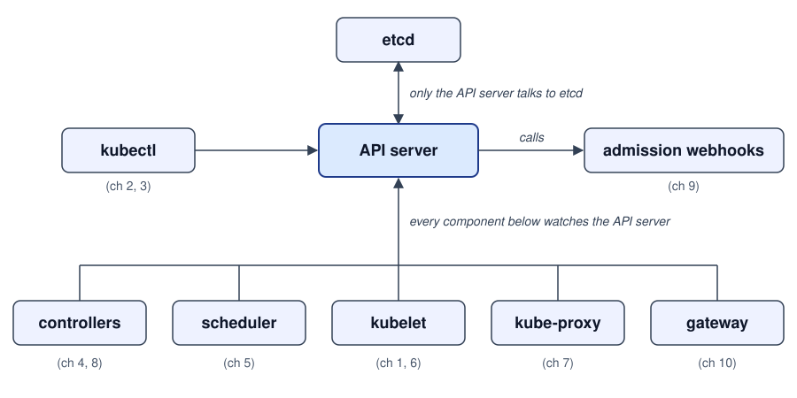

# Chapter 0: The map and the lab

Written for Kubernetes 1.34.0, kind 0.30.0, Go 1.24.

## What you will build

In this chapter you set up the lab: a small Kubernetes cluster that runs on your own laptop. Every later chapter uses it. You also get a map of Kubernetes, so you know what each part does and which chapter rebuilds it.

Kubernetes is a system for running programs on a group of machines. You tell it what you want running, for example "three copies of this web server", and it starts them, places them on machines with room, and starts them again if they stop. The group of machines is a cluster, and each machine in it is a node. Your lab cluster has three nodes.

At the end of the chapter you run one command, `make check`, that tests the lab. On an Apple Silicon Mac it ends like this:

```text
Cluster
  ok    kind cluster 'lab' exists
  ok    API server is v1.34.0
  ok    3 of 3 nodes Ready
  ok    can run commands inside lab-worker (arch aarch64)

The lab is ready.
```

## The map

### The words you need first

Kubernetes has its own words for the things it runs. You need four of them before the map makes sense.

- A container is a program packed with everything it needs to run, kept apart from the other programs on the same machine. Chapter 1 builds one by hand, so for now think of it as one running program.
- A pod is the unit Kubernetes runs. It holds one container, or a few that must run together on the same node.
- The control plane is the set of programs that make the decisions: what should run, and where. In your lab it runs on one node, `lab-control-plane`.
- The worker nodes run your pods. Your lab has two, `lab-worker` and `lab-worker2`.

Kubernetes stores everything you ask for as an object. A pod is an object, and so is a node. Each object is a short record, written in JSON or YAML (two plain-text formats for structured data), that says what you want.

### One hub

Kubernetes has one hub, the API server. API stands for application programming interface: a set of requests one program can send another. The API server is the one program that every other part of Kubernetes talks to. It keeps every object in a database called etcd, and it is the only program that reads or writes etcd.

You talk to the API server with kubectl, the Kubernetes command-line tool. When you type `kubectl get pods`, kubectl sends a request to the API server and prints the answer. The other parts of Kubernetes do the same thing, but from inside programs. None of them call each other. They only talk to the API server.

> **Everyday picture.** In a restaurant kitchen, the waiter clips each order ticket to a rail above the counter. The cooks never talk to the waiter or to each other. Each cook reads the rail, takes the tickets for their station and marks them done, and the stack of tickets is the only record of what the kitchen owes. **In Kubernetes,** the API server is the rail, etcd is the stack of tickets it keeps, and each part of Kubernetes is a cook that watches for its own kind of ticket.



The map shows each part and the chapter where you rebuild it. You meet each one properly in its own chapter. For now, one line each:

- Controllers keep the number of running pods right, and do many other jobs like it (chapters 4 and 8).
- The scheduler picks a node for each new pod (chapter 5).
- The kubelet runs on every node and starts that node's pods (chapters 1 and 6).
- kube-proxy runs on every node and sends network traffic to the right pods (chapter 7).
- Admission webhooks check each new object before the API server stores it (chapter 9).
- A gateway lets traffic from outside the cluster reach your pods (chapter 10).

### Every part runs the same loop

> **Everyday picture.** A thermostat holds a target temperature. It reads the room, compares it with the target and turns the heating on or off to close the gap. It does not care how the room got cold, and it keeps checking after the room is warm. **In Kubernetes,** an object is the target (the desired state), what is running now is the room (the actual state), and a program that closes the gap in a loop is a controller.

Every part on the map works like that thermostat. It watches the API server for the objects it cares about. It compares what those objects ask for with what exists. Then it acts to close the gap, and writes what it did back to the API server, where the next part sees it.

### Follow one request

Here is what happens when you ask for three copies of a web server. You do it with a Deployment, an object that says "keep this many copies of this pod running".

1. You run `kubectl apply`. kubectl sends the Deployment to the API server, and the API server stores it in etcd. In chapter 2 you send requests like this one with curl, a command-line tool that sends web requests.
2. A controller sees the new Deployment. It creates a ReplicaSet, an object whose only job is to keep a count of matching pods. A second controller sees the ReplicaSet, counts zero pods, and creates three Pod objects. Nothing runs yet; these are only records. You build this second controller in chapter 4.
3. The scheduler sees three pods with no node. It picks a node for each one and writes that choice back to the API server. The record of the choice is an object called a Binding. You build a scheduler in chapter 5.
4. The kubelet on each chosen node sees a pod assigned to it, and starts the pod's containers. You build a kubelet in chapter 6, and it uses the container code from chapter 1.
5. You create a Service, an object that gives the three pods one fixed network address. kube-proxy sees it and sets up rules in the Linux kernel, the core of the operating system, so traffic to that address reaches one of the pods. You build this in chapter 7.

Notice that no step calls the next one. Each part writes to the API server, and the next part notices. That is why you can swap any one part for a program of your own. This book does that, one part per chapter.

## Scope

| This book covers | This book leaves out |
| --- | --- |
| One cluster on one laptop, with three nodes | Clusters with several control-plane nodes, which keep running when one fails |
| Kubernetes 1.34.0, installed by kind 0.30.0 | Other versions, and other ways to run Kubernetes on a laptop (minikube, k3d) |
| Apple Silicon Macs, Linux, and Windows through WSL2 | Clusters rented from a cloud provider |

## Set up

### The tools and what each one does

You need seven tools. Here is what each one is for, before you install it.

- Homebrew installs software on a Mac. You use it to install the next three tools.
- Go is the programming language you write every program in this book with.
- kubectl is the Kubernetes command-line tool from the map above.
- jq reads and filters JSON on the command line. Chapter 2 uses it a lot.
- Docker runs containers on your laptop. On a Mac you get it from Docker Desktop, OrbStack or Colima; any one of the three works.
- kind builds a Kubernetes cluster out of Docker containers. Its name stands for "Kubernetes in Docker".
- make runs named commands that a project writes down in a file called a Makefile. Macs and Linux machines have it already. When this book says `make lab`, make looks up the `lab` entry in the Makefile and runs the commands listed there.

> **Everyday picture.** A flight simulator gives a pilot a real cockpit, with real instruments and real controls, bolted to the floor instead of a plane. **In Kubernetes,** kind is the simulator. Each node runs the real Kubernetes programs, but the "machine" under each node is a Docker container on your laptop, not a separate computer.

### Install the tools

On a Mac with Homebrew, install Go, kubectl and jq:

```bash
brew install go kubectl jq
```

Install kind yourself, at version 0.30.0, so you run the same version this book was tested with:

```bash
curl -sSLo kind https://github.com/kubernetes-sigs/kind/releases/download/v0.30.0/kind-darwin-arm64
chmod +x kind
sudo mv kind /usr/local/bin/kind
kind version
```

On Linux, change `kind-darwin-arm64` in the address to `kind-linux-amd64` or `kind-linux-arm64`, to match your machine.

Then install one of the Docker runtimes and start it. In its settings, give it at least 4 CPUs and 8 GB of memory, because three nodes run inside it.

### Create the cluster

From the top folder of this repo, run:

```bash
make lab
make check
```

`make lab` asks kind to build the cluster described in `lab/kind-config.yaml`, then waits until every node says it is Ready. That file names the exact Kubernetes build to use, by a fingerprint of its contents called a digest. Because of the digest, every reader runs the same Kubernetes programs, byte for byte.

`make check` then tests the tools and the cluster, and prints `ok` or `FAIL` for each test. Now ask the cluster for its nodes:

```bash
kubectl get nodes
```

```text
NAME                STATUS   ROLES           AGE   VERSION
lab-control-plane   Ready    control-plane   60s   v1.34.0
lab-worker          Ready    <none>          45s   v1.34.0
lab-worker2         Ready    <none>          45s   v1.34.0
```

## Where your code runs

kind runs each node as a Docker container. On a Mac there is one more layer. Docker needs Linux, so Docker Desktop, OrbStack and Colima each run a small Linux virtual machine: a pretend computer, made in software, running inside your Mac. So your nodes are Linux containers, inside a Linux virtual machine, inside macOS.

You can step inside a node. The first command below lists the running containers by name. The second opens a shell inside `lab-worker`:

```bash
docker ps --format '{{.Names}}'
docker exec -it lab-worker bash
```

Inside the node you are the root user of a small Linux machine. Three programs there matter for this book. systemd is the Linux program that starts other programs at boot and restarts them if they stop. containerd is the program that runs containers. The kubelet from the map tells containerd what to run. Try these:

```bash
uname -m                      # aarch64 on Apple Silicon
systemctl status kubelet --no-pager | head -5
crictl ps                     # the containers this node runs
exit
```

`uname -m` prints the chip type. `systemctl status kubelet` asks systemd whether the kubelet is running. `crictl ps` asks containerd which containers it is running.

Chapters 1, 6 and 7 use features of the Linux kernel, so their programs must run on Linux. For those chapters, the Makefile builds your Go program for the node's chip, copies it into a node with `docker cp`, and runs it there with `docker exec`. Every other chapter runs your program on your Mac. It talks to the API server over the network, the same way kubectl does.

## Break it

Stop one node, and watch the control plane notice:

```bash
docker stop lab-worker2
kubectl get nodes -w
```

The `-w` flag tells kubectl to keep watching and print each change. Within about a minute, `lab-worker2` turns `NotReady`. Notice that nothing told the control plane the node had died. So how did it find out?

> **Everyday picture.** A night guard calls the front desk every hour to say all is well. If the desk hears nothing for two hours, it sends someone to look; it does not wait for the guard to report a problem. **In Kubernetes,** the hourly call is a Lease: a small object the kubelet on each node updates on a timer. A controller called the node lifecycle controller watches the Leases, and treats a Lease that stops changing as a node that has died.

Each kubelet renews its node's Lease every few seconds. When `lab-worker2` stopped, its Lease stopped changing, and the node lifecycle controller marked the node `NotReady`. You write that renewal yourself in chapter 6.

Now start the node again:

```bash
docker start lab-worker2
```

The node returns to `Ready` as soon as its kubelet renews the Lease again.

## Design notes

Why kind, and not a lighter tool? kind runs the same programs that a production cluster runs: the API server (`kube-apiserver`), etcd, the scheduler (`kube-scheduler`), the controllers (`kube-controller-manager`) and the kubelet. It sets them up with kubeadm, the standard Kubernetes installer. That matters for this book, because every chapter compares your program with the real one. Some lighter tools save memory by replacing etcd with another database, or by joining the parts into one program. That would change behavior the chapters measure, such as how long the API server remembers past changes.

## Improving and expanding

1. Easy: add a third worker node to `lab/kind-config.yaml`, then delete and recreate the cluster. Chapter 5's scheduler has more choices to make with more nodes.
2. Easy: run `kubectl get --raw /api/v1/nodes | jq '.items[].status.nodeInfo'`. It asks the API server for every node, and jq picks out what each node reports about itself. Compare the three.
3. Medium: change `kubeProxyMode` in `lab/kind-config.yaml` from `iptables` to `nftables`. Both are ways to write network rules into the Linux kernel; nftables is the newer one. Recreate the cluster, and run `docker exec lab-worker nft list ruleset | head -50` to see the rules. Chapter 7 explains them.

## Further reading

- [kind quick start](https://kind.sigs.k8s.io/docs/user/quick-start/)
- [Kubernetes components](https://kubernetes.io/docs/concepts/overview/components/)
- [Kamal Marhubi, Kubernetes from the ground up](https://kamalmarhubi.com/blog/2015/09/06/kubernetes-from-the-ground-up-the-api-server), which starts the Kubernetes programs one at a time
