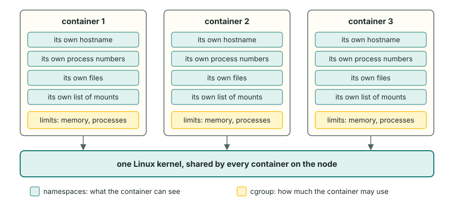
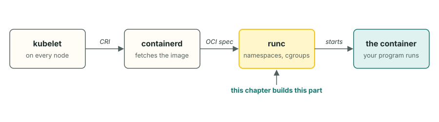

# Chapter 1: A container by hand

This chapter was written and tested with Kubernetes 1.34.0 (the kind 0.30.0 node image) and Go 1.24.

## What you will build

A container runtime: the program that starts containers. Yours is about 200 lines of Go. By the end of the chapter it can start a shell that believes it has the computer to itself, and it can stop that shell from using too much memory or starting too many programs.

Here is the finished runtime at work. Lines that start with `$` or `/ #` are prompts: the shell prints them to show it is waiting for a command. You do not type them; you type what comes after them.

```text
$ step4 run /root/rootfs /bin/sh
parent: pid 4127, starting [/bin/sh]
child:  pid 1, running [/bin/sh]
/ # hostname
container
/ # ps
PID   USER     COMMAND
    1 root     /proc/self/exe child /root/rootfs /bin/sh
    6 root     /bin/sh
    7 root     ps
/ # for i in $(seq 1 40); do sleep 1 & done
/bin/sh: can't fork: Resource temporarily unavailable
```

Read it line by line.

- `step4 run /root/rootfs /bin/sh` starts the runtime. It says: use the folder `/root/rootfs` as the container's files, and inside the container start `/bin/sh`, a shell.
- The `parent:` and `child:` lines are the runtime reporting what it does. Step 1 explains them.
- Inside the container, `hostname` asks for the computer's name, and gets `container`, not the node's real name.
- `ps` lists the running programs, and sees only three. The first one, `/proc/self/exe child ...`, is the runtime itself; step 1 explains that name too.
- The last command asks the shell to start 40 copies of `sleep 1`, a program that just waits for one second. The shell refuses with "can't fork": fork is how Linux starts a new process (step 1 explains it), and "Resource temporarily unavailable" is the kernel saying no, because your runtime set a limit.

Here is what you are building, in one picture. Keep it in mind for the rest of the chapter.



Three containers sit on top of one Linux kernel. Each container has its own hostname, its own process numbers, its own files and its own list of mounts: the teal boxes. Each one also has its own limits: the yellow box. The rest of this section names those two kinds of box.

First, two words. A process is one running program. Linux gives each process a number, its process ID, or pid. And as chapter 0 said, the kernel is the core of the operating system: every process asks the kernel when it wants to read a file, start another process or use memory.

> **Everyday picture.** Guests in a hotel share one building, one water supply and one power line, but each room has its own number, its own key and its own circuit breaker, and no guest can see into the next room. Nobody builds a new hotel for each guest.
>
> **In Linux,** each container is a room. Every container on a node shares the one Linux kernel. The kernel gives each container its own view of the computer, using a feature called namespaces, and its own limits, using a feature called control groups, or cgroups. In the picture, the teal boxes are the container's namespaces, and the yellow box is its cgroup. This chapter builds both.

So a container is not a small virtual machine. It is an ordinary Linux process that the kernel shows a limited view of the computer. This chapter builds that view one piece at a time. In chapter 6, your own kubelet uses this runtime to run pods.

The design follows Liz Rice's talk [Containers From Scratch](https://gotopia.tech/sessions/380/containers-from-scratch) ([code](https://github.com/lizrice/containers-from-scratch)).

## What the real one does

In a real cluster, three programs share the work of starting a container, and they talk to each other through two standards. (A standard, sometimes called a spec, short for specification, is a written agreement about how two programs talk.) Here is the chain, from left to right:



> **Everyday picture.** A wall socket follows a standard, so any lamp or kettle with the right plug works in any house.
>
> **In Kubernetes,** the Container Runtime Interface (CRI) is the socket between the kubelet and a container runtime such as containerd. The Open Container Initiative (OCI) runtime spec is a second socket, between containerd and a smaller program called runc. Either side of each socket can be swapped for another program that fits the same standard.

Now follow the arrows in the picture, one step at a time.

1. The kubelet sees a pod assigned to its node. Over the CRI, it asks containerd to start the pod's containers.
2. containerd downloads the container's image: a packaged copy of every file the program needs.
3. containerd unpacks the image into a folder, and writes a settings file in JSON that says what to run and with what limits.
4. containerd hands that folder and settings file to [runc](https://github.com/opencontainers/runc).
5. runc does the work this chapter does by hand. It sets up the namespaces and cgroups, prepares the container's files, and starts the container's first process.

runc also does a lot that this chapter skips, mostly for security. It gives each container its own network. It takes away powers that the root user (the administrator account, from chapter 0) normally has. And it blocks dangerous requests to the kernel. The scope table below lists what you skip, and the design notes at the end explain the most important gaps.

## Scope

You do not need to know the words in this table yet. Everything on the left is explained when the chapter reaches it. Everything on the right is for later reading.

| This chapter covers | This chapter leaves out |
| --- | --- |
| A UTS namespace: the container's own hostname | A network namespace: here the container shares the node's network |
| A PID namespace: the container's own process numbers | IPC namespaces (for inter-process communication, programs sending each other messages), cgroup namespaces and user namespaces |
| `chroot` into a busybox folder: the container's own files | Images and layers: you unpack one image by hand instead |
| A mount namespace, with a private `/proc` and `/dev` | Capabilities, seccomp and AppArmor: security features that limit what root may do |
| cgroup limits on processes and memory, for cgroup versions 1 and 2 | Limits on CPU, and on reading and writing the disk |
| Exit codes and signals passed back to you | `pivot_root`, a stronger version of `chroot` (see the design notes) |

## Set up

You need the lab from [chapter 0](../00-map-and-lab/README.md). Open a terminal in the top folder of the book's code (the `k8s-book` folder from chapter 0), and type:

```bash
cd chapters/01-container-by-hand
make install rootfs
```

`cd` moves your terminal into this chapter's folder. Your runtime uses Linux kernel features, so it has to run on Linux, inside a node. The two `make` commands get it there. The same commands work on a Mac, on Linux and in WSL2.

`make install` builds the four steps of this chapter, `step1` to `step4`. Go compiles your code: it turns the source code you write into a binary, one file that the computer can run. Your node runs Linux, so Go has to build a Linux binary even when you work on a Mac. Building for a different system than the one you build on is called cross-compiling, and the setting `GOOS=linux` asks Go to do it. make then copies the four binaries into the folder `/usr/local/bin` on the node. Linux looks for programs in that folder, so you can type `step1` from any folder on the node.

`make rootfs` gives your containers their files. It uses busybox, a tiny Linux toolkit that packs `sh`, `ls`, `ps` and many other commands into one small program. make starts a busybox container with Docker, copies out all of its files as one archive file (many files packed into one), and unpacks them into the folder `/root/rootfs` on the node. That folder is the only image this chapter uses.

Now open a root shell on the node: a shell that runs as the root user, which this chapter needs because namespaces and cgroups are administrator tools. It is the same as `docker exec -it lab-worker bash` from chapter 0:

```bash
make shell
```

Every command from here to "Run it beside the real one" runs inside that shell, on the node.

### How to read the shell commands in this chapter

The commands in this chapter use a few shell features that chapter 0 did not. Here they are, all in one place.

- `a; b` runs command `a`, then command `b`.
- `a &` starts `a` in the background: the shell does not wait for it to finish before taking the next command.
- `$(a)` runs command `a`, then drops its output into the line, as if you had typed it there.
- `x=hello` stores the text `hello` in a shell variable named `x`, and `$x` reads it back.
- `$$` is the pid of the shell itself, and `$?` is the exit code of the last command (every command ends with a number; 0 means it worked).
- `for i in $(seq 1 40); do sleep 1 & done` is a loop. `seq 1 40` prints the numbers 1 to 40, and the loop runs `sleep 1 &` once for each number.
- `sh -c 'some commands'` starts a new shell that runs the text in quotes as commands. The single quotes pass the text along exactly as written, so the outer shell does not touch anything inside them, such as `$$`.
- `echo` prints its words. `ls` lists the files in a folder. `grep TEXT FILE` prints only the lines of a file that contain `TEXT`. `wc -l` counts lines.

### How to read the Go in this chapter

You do not need to know Go to follow this chapter. The code uses only a handful of Go features, and here they are, so nothing in the listings is a surprise.

> **Everyday picture.** A recipe book has one recipe called "dinner" that says "make the soup, then make the bread", and separate recipe cards for the soup and the bread.
>
> **In Go,** each recipe card is a function: a named block of steps. The program always starts at the function called `main`, and `main` calls the other functions in turn.

- `package main` on the first line says "this file is a program you can run". A package is a named collection of Go code.
- `import` lists the packages from Go's standard library (the code that comes with Go) that the program uses. This chapter uses `fmt` to print text, `os` to read the command line and exit, `os/exec` to start other programs, and `syscall` to make system calls: the requests a program sends to the kernel.
- `func run(args []string)` starts a function called `run`. Inside the parentheses is what it takes: `args`, a list of strings. A string is a piece of text, and `[]string` means "a list of strings".
- `cmd := exec.Command(...)` makes a new variable called `cmd` and gives it its first value. A variable is a named box that holds a value. `:=` creates the box; a plain `=` puts a new value into a box that already exists.
- `os.Args` is the list of words you typed to start the program. For `step1 run hostname`, `os.Args[0]` is `step1`, `os.Args[1]` is `run` and `os.Args[2]` is `hostname`. `os.Args[2:]` means "every word from position 2 to the end".
- Many Go functions hand back an error value. The value `nil` means "no error". `if err != nil` means "if there was an error". This chapter checks errors with a tiny helper function, `must`, which prints the error and stops the program if anything went wrong.
- `fmt.Printf` prints text with slots in it: `%d` is filled with a number, `%v` with any value, and `%q` with text in quotes. `\n` means "start a new line". `fmt.Fprintln(os.Stderr, ...)` prints a line to stderr, the place for error messages.
- `&syscall.SysProcAttr{...}` builds a record of settings, with named fields inside the curly brackets. The `&` hands over the place where the record is stored, so the code that receives it works on this record, not on a copy.
- Some settings are on/off switches packed into one number. A computer stores every number as bits, each 0 or 1 (off or on). `syscall.CLONE_NEWUTS | syscall.CLONE_NEWPID` combines two such numbers with `|`, so both switches are on.
- `cg.remove()` calls the function `remove` that belongs to `cg`. A function that belongs to a value like this is called a method.
- `defer` schedules a line to run when the current function finishes. `range` goes through a list or table one item at a time, and `_` stands for "a value we do not need".
- Lines that start with `//` are comments: notes for the reader that Go ignores.

Each listing below is labeled with the file it comes from, and each file name links to the whole file. Click it, and the file opens beside the text. The listings show only the lines that matter for that step.

## Build it

Here is the whole runtime you are about to build, in one picture. Come back to it at each step to see where the new code fits.


Read it from the top. You type the command. The parent, on the left, does the work that must happen outside the container, then starts the child. The child, on the right, is already inside the new namespaces, so it can set up the container's view before your command starts. When your command ends, its exit code travels back to the parent, along the dashed line.

Each line in the picture names the step of this chapter that adds it. Step 1 builds the frame: the parent, the child, a new UTS namespace, the hostname, and running your command. Steps 2, 3 and 4 fill in the rest.

### Step 1: a new hostname

The smallest container changes one thing: the hostname, the name a computer calls itself.

> **Everyday picture.** A hotel has one street address, but the number on your door belongs to your room alone, and changing it does not change the building's address.
>
> **In Linux,** a namespace is that door number: the kernel gives a process its own copy of one thing the computer normally shares. Linux has several kinds of namespace. The UTS namespace gives a process its own hostname. (UTS stands for "UNIX Time-sharing System". Unix is the 1970s operating system that Linux is modeled on, and the name stuck.)

One warning about the word. Kubernetes also has namespaces, such as `ch02` in chapter 2. Those are folders for Kubernetes objects, and they have nothing to do with Linux namespaces.

Now the trick in the code, the two big boxes in the picture. The program starts itself twice. The first copy, `run`, asks the kernel to start a second copy, `child`, inside a new namespace. The second copy sets the hostname and then runs your command.

Why start twice? Because the setup has to happen inside the new namespace, before your command starts. Linux starts a new program in two steps. First `fork` makes a copy of the running process. Then `exec` swaps that copy for the new program. A program written in C, an older language that works close to the kernel, can run its own setup code between those two steps. Go cannot. Every Go program runs the Go runtime, support code that does its work in several threads at once (parallel lines of work inside one process), and a copy made by `fork` can only safely run a few simple steps before `exec`. So instead, the program starts itself again inside the namespace, and does the setup at the start of that second copy.

Start where Go starts, at `main`. From [`step1/main.go`](https://github.com/aarora79/k8s-book/blob/main/chapters/01-container-by-hand/step1/main.go):

```go
func main() {
	if len(os.Args) < 3 {
		fmt.Fprintln(os.Stderr, "usage: step1 run <command> [args...]")
		os.Exit(2)
	}
	switch os.Args[1] {
	case "run":
		run(os.Args[2:])
	case "child":
		child(os.Args[2:])
	default:
		fmt.Fprintf(os.Stderr, "unknown command %q\n", os.Args[1])
		os.Exit(2)
	}
}
```

**Code walkthrough.** `main` decides which of the two jobs to do.

1. `len(os.Args)` counts the words you typed. Fewer than three means you left something out. So the program prints how to use it, with `fmt.Fprintln(os.Stderr, ...)`, and stops with `os.Exit(2)`. An exit code of 2 is the usual way to say "you called me wrong". In the usage line, `<command>` means "put a command here", and `[args...]` means "and any number of extra words, if you like".
2. `switch os.Args[1]` looks at the second word and picks a branch. A `switch` is a list of `case` lines, and Go runs the first case that matches.
3. When you type `step1 run hostname`, the second word is `run`, so `main` calls `run` with the rest of the words, `[hostname]`.
4. The `child` case is not for you to type. The program uses it when it starts its own second copy, as you see next.
5. Any other word reaches `default`, which prints an error with the word in quotes (`%q`) and stops.

Now the two functions that do the work, from the same file:

```go
// run starts this same program again as "child", inside a new UTS namespace.
func run(args []string) {
	fmt.Printf("parent: pid %d, starting %v\n", os.Getpid(), args)
	cmd := exec.Command("/proc/self/exe", append([]string{"child"}, args...)...)
	cmd.Stdin, cmd.Stdout, cmd.Stderr = os.Stdin, os.Stdout, os.Stderr
	cmd.SysProcAttr = &syscall.SysProcAttr{
		Cloneflags: syscall.CLONE_NEWUTS,
	}
	exitWith(cmd.Run())
}

// child runs inside the new namespace. It sets the hostname, then runs the
// user's command.
func child(args []string) {
	fmt.Printf("child:  pid %d, running %v\n", os.Getpid(), args)
	must(syscall.Sethostname([]byte("container")))

	cmd := exec.Command(args[0], args[1:]...)
	cmd.Stdin, cmd.Stdout, cmd.Stderr = os.Stdin, os.Stdout, os.Stderr
	exitWith(cmd.Run())
}
```

**Code walkthrough.** First `run`, which runs in the parent:

1. `fmt.Printf("parent: pid %d, ...")` prints the parent's pid, so you can compare it with the child's later.
2. `exec.Command("/proc/self/exe", ...)` prepares, but does not yet start, a new process. `/proc/self/exe` is a special path that always leads to the file of the program that is running. So the new process is a second copy of this same program, and `run` does not need to know where you installed it.
3. `append([]string{"child"}, args...)` builds the new copy's list of words. `[]string{"child"}` is a new list holding one word, `child`, and `append` adds your words after it. So the second copy starts as `step1 child hostname`, and its `main` picks the `child` case. Each `...` spreads a list out into separate words: the first spreads your words into `append`, and the second, after the closing parenthesis, spreads the finished list into `exec.Command`.
4. `cmd.Stdin, cmd.Stdout, cmd.Stderr = os.Stdin, os.Stdout, os.Stderr` sets three values in one line: the first name on the left gets the first value on the right, and so on. Stdin is what you type, stdout is normal output and stderr is error output. This line connects all three to your terminal. Without it, you would see nothing the child prints.
5. `cmd.SysProcAttr = &syscall.SysProcAttr{Cloneflags: syscall.CLONE_NEWUTS}` is the line that makes it a container. On Linux, the system call that creates a new process is called `clone`, and its flags say which new namespaces to give the new process. `CLONE_NEWUTS` asks for a new UTS namespace.
6. `exitWith(cmd.Run())` starts the process, waits for it to finish, and passes on how it ended.

Then `child`, which runs in the second copy, already inside the new namespace:

1. It prints its own pid.
2. `syscall.Sethostname([]byte("container"))` asks the kernel to change the hostname to `container`. The kernel wants bytes, not text, and `[]byte(...)` converts one to the other. (A byte is the basic unit of storage, 8 bits, enough for one letter.) Because the child has its own UTS namespace, this changes only the child's hostname.
3. `exec.Command(args[0], args[1:]...)` prepares your command. The first word, `args[0]`, is the program to run, and the rest are its arguments.
4. It connects your terminal again, then runs your command and passes on how it ended.

Last, the two small helpers at the bottom of the file:

```go
// exitWith exits with the command's own exit code, so callers can tell
// success from failure.
func exitWith(err error) {
	if exitErr, ok := err.(*exec.ExitError); ok {
		if ws, ok := exitErr.Sys().(syscall.WaitStatus); ok && ws.Signaled() {
			fmt.Fprintf(os.Stderr, "killed by signal: %v\n", ws.Signal())
			os.Exit(128 + int(ws.Signal()))
		}
		os.Exit(exitErr.ExitCode())
	}
	must(err)
	os.Exit(0)
}

func must(err error) {
	if err != nil {
		fmt.Fprintln(os.Stderr, "error:", err)
		os.Exit(1)
	}
}
```

Every command ends with an exit code. A process can also end because it got a signal: a short message from the kernel. Some signals ask a process to stop, and signal 9 stops it at once, with no chance to refuse.

1. `exitWith` makes the runtime end with the same exit code as your command, so a script that runs your container can tell whether the command worked.
2. `exitErr, ok := err.(*exec.ExitError)` asks "is this error the kind that means the command ran but ended badly?" This is called a type check. It gives back two values: the error in its more detailed form, and `ok`, which is true if the answer is yes. `if a; b` runs `a` first, then tests `b`.
3. `ws.Signaled()` asks "was the command stopped by a signal?" If so, and `&&` means both tests must be true, the runtime prints which signal and exits with 128 plus the signal's number. `int(...)` turns the signal into a plain number so it can be added. This is the same rule a Linux shell follows, which is why you see exit code 137 (128 plus 9) in step 4.
4. Otherwise, it exits with the command's own code.
5. If the error was something else, for example a command that does not exist, `must(err)` prints it and exits with 1. If there was no error at all, the runtime exits with 0.
6. `must` is the helper from the primer above: if `err` is not `nil`, print it and stop.

Run it on the node. The first command runs `hostname` inside a container; the second runs `hostname` on the node itself, outside any container, so you can compare:

```bash
step1 run hostname
hostname
```

```text
parent: pid 1781, starting [hostname]
child:  pid 1786, running [hostname]
container
lab-worker
```

Your command printed `container`, but the node kept its name, `lab-worker`. The child's pid is 1786, an ordinary number on the node. That is because the child still sees the node's full list of processes. Step 2 fixes that.

### Step 2: process 1 and a root filesystem

Three more changes make it feel like a container: its own process numbers, its own files, and a list of processes that shows only its own.

First, the process numbers. A PID namespace gives the child its own set of pids, so the first process inside is number 1, just as on a freshly started computer.

Second, the files. A filesystem is the way the kernel arranges files and folders, on a disk or in memory. On Linux every file path starts at `/`, the root, and the whole tree of folders that starts there is the root filesystem.

> **Everyday picture.** A hotel key opens one room, and to the guest that room is the whole building: they cannot walk into a room they cannot open.
>
> **In Linux,** the container's root filesystem is the room. The `chroot` system call (short for "change root") sets which folder a process treats as `/`. After `chroot`, the process cannot even name a file outside that folder. The design notes explain where this picture breaks down.

Here the busybox folder becomes the child's `/`.

Third, the list of processes. Tools like `ps` read it from `/proc`, a special folder the kernel fills in as you read it. To give the child a `/proc` of its own, the child mounts one.

> **Everyday picture.** Plug a USB stick into a laptop and its files appear under one folder; unplug it and they vanish.
>
> **In Linux,** attaching a set of files at a folder is called mounting, and taking them away again is unmounting. The kernel keeps a list of every mount, called the mount table.

The child mounts a fresh `/proc` that shows only the processes in its own PID namespace.

The diff from step 1, in [`step2/main.go`](https://github.com/aarora79/k8s-book/blob/main/chapters/01-container-by-hand/step2/main.go) (a diff shows only what changed):

```go
	cmd.SysProcAttr = &syscall.SysProcAttr{
		// New: CLONE_NEWPID gives the child its own process numbers.
		Cloneflags: syscall.CLONE_NEWUTS | syscall.CLONE_NEWPID,
	}
```

```go
	// New: make rootfs the child's "/", then mount a fresh /proc so tools
	// like ps read this PID namespace instead of the host's.
	must(syscall.Chroot(rootfs))
	must(os.Chdir("/"))
	must(os.MkdirAll("/proc", 0o755))
	must(syscall.Mount("proc", "/proc", "proc", 0, ""))

	cmd := exec.Command(args[0], args[1:]...)
	cmd.Stdin, cmd.Stdout, cmd.Stderr = os.Stdin, os.Stdout, os.Stderr
	err := cmd.Run()

	must(syscall.Unmount("/proc", 0))
	exitWith(err)
```

**Code walkthrough.** In [`step2/main.go`](https://github.com/aarora79/k8s-book/blob/main/chapters/01-container-by-hand/step2/main.go):

1. `syscall.CLONE_NEWUTS | syscall.CLONE_NEWPID` asks for two namespaces now, the UTS namespace from step 1 plus a new PID namespace.
2. `syscall.Chroot(rootfs)` makes the busybox folder the child's `/`. `rootfs` holds the folder you typed after `run`, here `/root/rootfs`. Step 2's `main` takes it from `os.Args[2]` and passes it along.
3. `os.Chdir("/")` moves the child into its new `/`. Chdir is short for "change directory", the same job as `cd` in the shell. `chroot` changes where paths start, but not the folder the process is standing in, so without this line the child would still be standing in a folder outside its new root.
4. `os.MkdirAll("/proc", 0o755)` makes sure the folder `/proc` exists, because a mount needs a folder to attach to and Podman's busybox export leaves this one out. Step 3 explains the `0o755`.
5. `syscall.Mount("proc", "/proc", "proc", 0, "")` mounts a fresh `/proc`. Read the five values in order: what to mount (`proc`), where to put it (`/proc`), what kind of filesystem it is (also `proc`), extra settings (`0`, none), and extra options (`""`, none). Because this happens inside the new PID namespace, the new `/proc` lists only the child's processes.
6. `err := cmd.Run()` runs your command, and keeps the result in `err` instead of exiting right away.
7. `syscall.Unmount("/proc", 0)` takes the `/proc` mount away again, then `exitWith(err)` ends the program. Remember these two lines: step 3 shows why they are not enough.

Now run it. The `sh -c '...'` part asks busybox's shell to run three commands: print its own pid (`$$`), list the processes, and list the files in `/`:

```bash
step2 run /root/rootfs /bin/sh -c 'echo "my pid is $$"; ps; ls /'
```

```text
parent: pid 1841, starting [/bin/sh -c echo "my pid is $$"; ps; ls /]
child:  pid 1, running [/bin/sh -c echo "my pid is $$"; ps; ls /]
my pid is 6
PID   USER     COMMAND
    1 root     /proc/self/exe child /root/rootfs /bin/sh -c echo "my pid is $$"; ps; ls /
    6 root     /bin/sh -c echo "my pid is $$"; ps; ls /
    7 root     {ps} /bin/sh -c echo "my pid is $$"; ps; ls /
bin
dev
etc
...
```

Your Go program is process 1. Why did the shell get 6 and not 2? The Go runtime's threads took 2 to 5, because on Linux each thread takes a number from the same pool as processes. The third line is `ps` itself, listing itself. Last, `ls /` shows busybox's files, not the node's.

### Step 3: mounts of its own, and /dev

Step 2 has a leak. It mounted the fresh `/proc`, but it had no mount namespace of its own. So that mount went into the node's own mount table, and only the `Unmount` line at the end of the program takes it out again. Kill the container before that line runs, and the mount stays behind on the node. "Break it" below shows this.

A mount namespace gives a process its own copy of the mount table, so what it mounts stays out of everyone else's list. Step 3 adds one.

One more detail matters here. On computers that run systemd, which includes kind nodes, systemd marks every mount as shared. A shared mount copies each new mount into other namespaces too, which is called mount propagation, and it would undo the point of the namespace. So the child first marks every mount private: not shared with anyone.

From [`step3/main.go`](https://github.com/aarora79/k8s-book/blob/main/chapters/01-container-by-hand/step3/main.go):

```go
		// New: CLONE_NEWNS gives the child its own list of mounts.
		Cloneflags: syscall.CLONE_NEWUTS | syscall.CLONE_NEWPID | syscall.CLONE_NEWNS,
```

```go
	// New: hosts that run systemd share mounts between namespaces by default.
	// Mark every mount private so the /proc we mount below stays in here.
	must(syscall.Mount("", "/", "", syscall.MS_PRIVATE|syscall.MS_REC, ""))

	// New: a /dev of the container's own, also private to this namespace. It
	// comes before chroot because it borrows device files from the node's /dev.
	must(mountDev(rootfs))

	must(syscall.Chroot(rootfs))
	must(os.Chdir("/"))
	must(os.MkdirAll("/proc", 0o755))
	must(syscall.Mount("proc", "/proc", "proc", 0, ""))
```

**Code walkthrough.** In [`step3/main.go`](https://github.com/aarora79/k8s-book/blob/main/chapters/01-container-by-hand/step3/main.go):

1. `syscall.CLONE_NEWNS` adds a mount namespace. (NS stands for "namespace". Mount namespaces were the first kind Linux had, so they got the plain name.)
2. `syscall.Mount("", "/", "", syscall.MS_PRIVATE|syscall.MS_REC, "")` changes a setting on mounts that already exist, instead of making a new one. `MS_PRIVATE` marks a mount private, and `MS_REC` means "and every mount below it too". Together they make every mount the child can see private.
3. `mountDev(rootfs)` is new, and the next listing shows it. It runs before `chroot`, because after `chroot` the child can no longer reach the node's `/dev`.
4. The `chroot`, `chdir` and `/proc` lines are the same as step 2.

The `Unmount` at the end is gone. When the last process in the namespace exits, the kernel throws away the namespace, and its mounts go with it.

Programs also expect a few special files in `/dev`, called device files. Reading or writing a device file talks to a driver, a piece of kernel code that runs one kind of device. Some devices are real hardware, but these four are made up by the kernel: `/dev/null` throws away anything written to it, `/dev/zero` gives back endless zero bytes, and `/dev/random` and `/dev/urandom` give back random bytes.

The busybox folder has an empty `/dev`. So `mountDev` mounts a `tmpfs` there (a small filesystem that lives in memory) and fills it with the node's four device files. The usual way to make a device file is the `mknod` system call, but a node on rootless Podman is not allowed to use it. So the code uses a bind mount, which makes something that already exists appear at a second place. Each device file in the container is the node's own device file, seen through a second path:

```go
func mountDev(rootfs string) error {
	dev := filepath.Join(rootfs, "dev")
	if err := os.MkdirAll(dev, 0o755); err != nil {
		return err
	}
	if err := syscall.Mount("tmpfs", dev, "tmpfs", syscall.MS_NOSUID, "mode=755"); err != nil {
		return err
	}
	for _, name := range []string{"null", "zero", "random", "urandom"} {
		target := filepath.Join(dev, name)
		if err := os.WriteFile(target, nil, 0o666); err != nil { // the mount point
			return err
		}
		if err := syscall.Mount("/dev/"+name, target, "", syscall.MS_BIND, ""); err != nil {
			return err
		}
	}
	return nil
}
```

**Code walkthrough.** `mountDev` in [`step3/main.go`](https://github.com/aarora79/k8s-book/blob/main/chapters/01-container-by-hand/step3/main.go):

1. `filepath.Join(rootfs, "dev")` builds the path of the container's `/dev`, here `/root/rootfs/dev`.
2. `if err := os.MkdirAll(dev, 0o755); err != nil { return err }` makes sure that folder exists, and if that fails, hands the error back to the caller, where `must` reports it. Every step in this function follows the same pattern.
3. `0o755` is a set of file permissions, written as three digits in base 8. The digits are for the file's owner, for its group (a set of users), and for everyone else. Each digit adds up 4 for read, 2 for write and 1 for run (or, for a folder, enter). So 7 is all three, and 5 is read and enter. The owner may do everything, and everyone else may read and enter.
4. `syscall.Mount("tmpfs", dev, "tmpfs", syscall.MS_NOSUID, "mode=755")` mounts an empty in-memory filesystem on that folder. `MS_NOSUID` is a safety setting: it stops any program on this filesystem from gaining extra powers when it starts.
5. `[]string{"null", "zero", "random", "urandom"}` is a list of the four device names. `for _, name := range ...` goes through the list one name at a time, and `_` throws away each name's position, which the code does not need.
6. `os.WriteFile(target, nil, 0o666)` creates an empty ordinary file. A bind mount needs something to attach to, and this file is it.
7. `syscall.Mount("/dev/"+name, target, "", syscall.MS_BIND, "")` attaches the node's device file on top of that empty file. `"/dev/"+name` joins two pieces of text, giving `/dev/null` and so on. `MS_BIND` asks for a bind mount. From now on, opening the file in the container opens the real device.
8. `return nil` at the end means "no error".

### Step 4: limits

Namespaces control what a process can see. Control groups, or cgroups, control how much it can use.

> **Everyday picture.** Each hotel room has its own circuit breaker. A guest who runs three heaters at once trips their own breaker and loses power, and the rest of the floor never notices.
>
> **In Linux,** a cgroup is that breaker for a group of processes. It caps how much memory and CPU they use and how many processes and threads they start. When a container goes over its memory cap, the kernel kills a process in it.

You work with a cgroup through ordinary files. Each cgroup is a folder under `/sys/fs/cgroup`. (`/sys` is another special folder that the kernel fills in, like `/proc`.) You write a limit into one of the folder's files, and you write a pid into its `cgroup.procs` file to put that process in the group. From then on, the kernel holds that process, and every process it starts, to the limits.

How does the child know which cgroup to join? The parent tells it through an environment variable: a named setting that a process passes on to the processes it starts. The parent cannot simply share a Go variable, because the child is a fresh copy of the program with its own memory.

Start with the parent. Its `run` function now sets up the cgroup before it starts the child. From [`step4/main.go`](https://github.com/aarora79/k8s-book/blob/main/chapters/01-container-by-hand/step4/main.go):

```go
func run(rootfs string, args []string, pids, memMB int) {
	fmt.Printf("parent: pid %d, starting %v\n", os.Getpid(), args)

	// New: create the cgroup and set its limits before the child starts.
	cg, err := newCgroup(fmt.Sprintf("hmlk8s-%d", os.Getpid()), pids, memMB)
	must(err)
	defer cg.remove()

	cmd := exec.Command("/proc/self/exe", append([]string{"child", rootfs}, args...)...)
	cmd.Stdin, cmd.Stdout, cmd.Stderr = os.Stdin, os.Stdout, os.Stderr
	cmd.Env = append(os.Environ(), "HMLK8S_CGROUP_PROCS="+cg.procsFiles())
	cmd.SysProcAttr = &syscall.SysProcAttr{
		Cloneflags: syscall.CLONE_NEWUTS | syscall.CLONE_NEWPID | syscall.CLONE_NEWNS,
	}
	err = cmd.Run()
	cg.remove() // os.Exit below skips deferred calls
	exitWith(err)
}
```

**Code walkthrough.**

1. `run` now takes two more values, `pids` and `memMB`: the limit on processes and the limit on memory, in MiB. A MiB (mebibyte) is 1,048,576 bytes, slightly more than a MB (megabyte), which is 1,000,000 bytes. `main` reads both limits from the `-pids` and `-memory-mb` options you type, using Go's `flag` package, which reads options like these. If you leave them out, it uses 20 and 100.
2. `fmt.Sprintf("hmlk8s-%d", os.Getpid())` builds a name such as `hmlk8s-4127` from the parent's pid, so two containers never pick the same cgroup name.
3. `cg, err := newCgroup(...)` creates the cgroup folder and writes the limits. Go functions can hand back more than one value, and this one hands back two: the cgroup, and an error. `must(err)` stops if creating it failed.
4. `defer cg.remove()` says "when `run` finishes, delete the cgroup".
5. `cmd.Env = append(os.Environ(), "HMLK8S_CGROUP_PROCS="+cg.procsFiles())` gives the child every environment variable the parent has (`os.Environ()`), plus one more, which holds the path of the cgroup's `cgroup.procs` file.
6. After the child finishes, `cg.remove()` runs once more by hand. The comment says why: `os.Exit`, inside `exitWith`, ends the program at once and skips anything scheduled with `defer`.

Next, the limits themselves. Linux has two versions of cgroups. kind nodes use version 2, where one folder holds every limit. Inside `newCgroup`:

```go
		return cg, cg.write([][2]string{
			{"pids.max", strconv.Itoa(pids)},
			{"memory.max", mem},
			{"memory.swap.max", "0"},
		})
```

**Code walkthrough.** These lines write three files in the new cgroup folder. `[][2]string{...}` is a list of pairs of strings: a file name, then the value to write into it.

1. `pids.max` gets the limit on processes, for example `20`. `strconv.Itoa` turns the number into text, because cgroup files hold text.
2. `memory.max` gets the memory limit in bytes. Earlier in `newCgroup`, the line `mem := strconv.Itoa(memMB * 1024 * 1024)` turned MiB into bytes, and then into text.
3. `memory.swap.max` gets `0`. Swap is disk space that Linux can use as extra memory. With swap at 0, a container that goes over its memory limit is killed, instead of quietly spilling onto the disk.
4. `cg.write` writes each pair in order, and returns an error if a required file is missing.

The child puts itself in the cgroup before it runs anything else. It writes `0` to `cgroup.procs`, and `0` there means "the process doing the writing": the simplest way for the child to say "me".

```go
	// New: join the cgroup. Writing "0" to cgroup.procs moves the writer
	// itself. Everything it starts from now on inherits the limits.
	for _, f := range filepath.SplitList(os.Getenv("HMLK8S_CGROUP_PROCS")) {
		must(os.WriteFile(f, []byte("0"), 0o644))
	}
```

**Code walkthrough.**

1. `os.Getenv("HMLK8S_CGROUP_PROCS")` reads the environment variable the parent set.
2. `filepath.SplitList(...)` splits it into a list of paths. On cgroup version 2 there is just one path. On version 1 there are two, one for each kind of limit.
3. `for _, f := range ...` goes through the paths one at a time. `range` gives back two values each time, the position and the path, and `_` throws away the position, which the code does not need.
4. `os.WriteFile(f, []byte("0"), 0o644)` writes `0` into each `cgroup.procs` file, which moves the child into the cgroup. `0o644` gives the permissions to use if the file has to be created; here it already exists, so they do not matter.
5. Everything the child starts after this, including your command, is held to the limits.

When the container exits, the parent deletes the cgroup folder. `step4/main.go` also works on older computers that use cgroup version 1, where each kind of limit has its own folder tree.

Now test both limits:

```bash
step4 run -pids 20 /root/rootfs /bin/sh -c 'for i in $(seq 1 40); do sleep 1 & done; wait'
step4 run -memory-mb 50 /root/rootfs /bin/sh -c 'x=$(head -c 200000000 /dev/zero | tr "\0" a)'
echo $?
```

The first command sets a limit of 20 and tries to start 40 `sleep 1` processes, then `wait`s for them. The second sets a memory limit of 50 MiB, then tries to fill a shell variable, `x`, with 200 million letters. `head -c 200000000 /dev/zero` reads 200 million zero bytes, `tr "\0" a` turns each one into the letter `a`, and `x=$(...)` stores all of it in `x`. Then `echo $?` prints the exit code.

```text
/bin/sh: can't fork: Resource temporarily unavailable
...
killed by signal: killed
137
```

The first command hit the limit. The limit counts threads as well as processes, and your runtime's own child already uses several threads, so the shell runs out of room before it reaches 20 sleeps. The `...` in the output stands for more lines that are cut here.

In the second command, the kernel's out-of-memory killer, the kernel code that picks a process to kill when memory runs out, stopped the shell. It did that with signal 9, which Go names "killed", and the exit code became 128 plus 9, so 137. Kubernetes reports the same event as `OOMKilled`, where OOM stands for out of memory.

## Run it beside the real one

Now compare your runtime with the real one. Leave the node's shell with `exit`, so these commands run on your laptop:

```bash
kubectl run sleeper --image=busybox:1.37 --overrides='{"spec":{"nodeName":"lab-worker"}}' -- sleep 3600
docker exec lab-worker sh -c 'pid=$(pgrep -f "sleep 3600" | head -1); ls -l /proc/$pid/ns; cat /proc/$pid/cgroup'
docker exec lab-worker sh -c 'step4 run /root/rootfs /bin/sh -c "ls -l /proc/self/ns"'
```

Here is what the three commands do.

1. `kubectl run sleeper --image=busybox:1.37 ...` creates a pod called `sleeper` with one container. `busybox:1.37` is the image name, `busybox`, and its version, `1.37`. `--overrides='{"spec":{"nodeName":"lab-worker"}}'` adds one field to the pod, `nodeName`, which puts it on `lab-worker`, the node your runtime runs on. Everything after `--` is the command the container runs: `sleep 3600`, a wait of one hour.
2. The second line runs a small script on the node. `pgrep -f "sleep 3600"` finds the pid of the pod's `sleep` process, and `head -1` keeps the first answer. `ls -l /proc/$pid/ns` lists that process's namespaces, and `cat /proc/$pid/cgroup` prints which cgroup it is in.
3. The third line starts your runtime on the node, and lists the namespaces of the `ls` command inside it. `/proc/self` always means "the process that is reading it".

`/proc/<pid>/ns` holds one entry per namespace. Each entry is a link, a file that points at something else, and it shows as something like `pid:[4026532290]`, where the number is an id for that namespace. Two processes share a namespace when those numbers match.

Compare the two lists. The pod's process has its own `net`, `ipc` and `cgroup` namespaces: its own network, its own channels for programs to talk to each other, and its own view of the cgroup tree. Your container shares all three with the node.

Then compare the cgroups. The pod's cgroup sits several folders deep, inside a tree called `kubepods` that the kubelet manages. The tree is grouped first by the pod's quality-of-service class and then by the pod's UID (its unique id). Kubernetes has three quality-of-service classes, Guaranteed, Burstable and BestEffort, which say how firmly Kubernetes protects a pod's memory and CPU. `sleeper` asks for no memory or CPU at all, so its class is BestEffort. Your container's cgroup sits at the top level, named `hmlk8s-<pid>`.

Clean up with `kubectl delete pod sleeper`.

## Break it

Open the node's shell again with `make shell` for these.

1. Kill a step 2 container, and look for its mount:

   ```bash
   step2 run /root/rootfs /bin/sleep 30 &
   sleep 1; pkill -9 -f 'exe child /root/rootfs'
   grep rootfs/proc /proc/self/mountinfo
   umount /root/rootfs/proc
   ```

   `step2 ... &` starts a container in the background, and `sleep 1` gives it a second to start. `pkill -9 -f 'exe child /root/rootfs'` sends signal 9 to every process whose command line contains that text, so the container dies at once and its `Unmount` line never runs. `grep rootfs/proc /proc/self/mountinfo` then searches the mount table, which `/proc/self/mountinfo` shows. It finds the `/proc` mount still on the node: it outlived the container. The last line, `umount` (spelled without an n), removes it by hand. Repeat with `step3`, and `grep` finds nothing.

2. Open `step3/main.go` on your laptop in a text editor, delete the line with `MS_PRIVATE` in it, save the file, and rebuild with `make install`. Then run the same experiment again with `step3`. The leak is back. On a computer that runs systemd, a mount namespace alone does not stop it. Put the line back afterward.

3. Run `step4 run -pids 5 /root/rootfs /bin/sh -c 'ls | wc -l'` with a limit of 5. Does it work? Count how many processes and threads that one line needs: the runtime's own child and its threads, the shell, `ls` and `wc`.

## Design notes

**Why runc uses `pivot_root` and not `chroot`.** Here the hotel picture breaks down. `chroot` changes where one process starts its paths, but it does not move the folder the process is standing in, and the node's real files are still there underneath. So a process running as root inside the container can escape. It makes a new folder, calls `chroot` on that folder, and is now standing outside its own root. From there, `cd ..` climbs one folder at a time, all the way up to the node's real `/`. `pivot_root` is stronger. It swaps the root for the whole mount namespace, and then runc unmounts the old root, so the node's files are gone from the container's view entirely. runc does this inside the container's own mount namespace, so the node itself is not affected.

**Why the double start.** runc is written in Go too, so it has the same problem as step 1: some setup must happen inside the new namespaces, but before the container's program starts. runc solves it with a small function written in C, called `nsexec`, that runs before the Go runtime starts. Then runc starts itself again, much like `/proc/self/exe child` here.

**Why cgroup version 2 puts everything in one folder.** Each kind of limit is run by a part of the kernel called a controller. In version 1, each controller had its own folder tree. A process could sit in one place in the memory tree and somewhere else in the process tree, and tools had to keep the trees matched by hand. Version 2 has one tree for every controller. That is why the version 2 code in `newCgroup` is shorter than the version 1 code.

**What this does not protect.** Your container runs as the node's real root user, with all of root's powers, and the kernel answers every request it makes. That matters, because the kernel is shared: every node in your lab, and your container app itself, run on the same kernel inside its virtual machine. A process inside your container could load new code into that kernel, or change kernel settings for everything running on it. (On rootless Podman, the node's root is an ordinary user of the virtual machine, which limits this damage. Your runtime does nothing to help.) runc blocks this in three ways. User namespaces make root inside the container an ordinary user outside it. Dropping capabilities takes away root's special powers one by one. seccomp filters the system calls a process may make.

## Improving and expanding

1. Easy: add a `-cpu` flag that writes the cgroup file `cpu.max`. The value `50000 100000` means 50,000 microseconds of CPU time in every 100,000, so half of one CPU. Test it with a loop that never stops, and watch it with `top` on the node, a tool that shows a live list of processes and how much CPU each one uses.
2. Medium: replace `chroot` with `pivot_root`. First make the busybox folder appear at a second place by mounting it onto itself (this is called a bind mount), because `pivot_root` only accepts a folder that is a mount.
3. Medium: let two containers share one image. Make the busybox folder read-only, and give each run its own writable layer on top of it with an `overlay` mount, which stacks a writable folder over a read-only one, so every change goes into the top folder only.
4. Medium: give the container its own network. Add `CLONE_NEWNET`, then use `ip link`, the Linux tool that creates network devices, in the parent to create a veth pair: a virtual network cable with one end in the node and one end in the container. Then give the container an IP address. Chapter 7 returns to this.
5. Hard: read the settings `process.args`, `hostname` and `linux.resources` from an OCI `config.json` settings file, so your runtime takes the same input as runc. (`process.args` means the field `args` inside the field `process`.)

## Further reading

- [Liz Rice, Containers From Scratch, GOTO 2018](https://gotopia.tech/sessions/380/containers-from-scratch)
- [runc](https://github.com/opencontainers/runc), the standard OCI runtime
- [Linux kernel documentation: Control Group v2](https://docs.kernel.org/admin-guide/cgroup-v2.html)
- The Linux manual pages for [namespaces](https://man7.org/linux/man-pages/man7/namespaces.7.html) and [mount namespaces](https://man7.org/linux/man-pages/man7/mount_namespaces.7.html)
